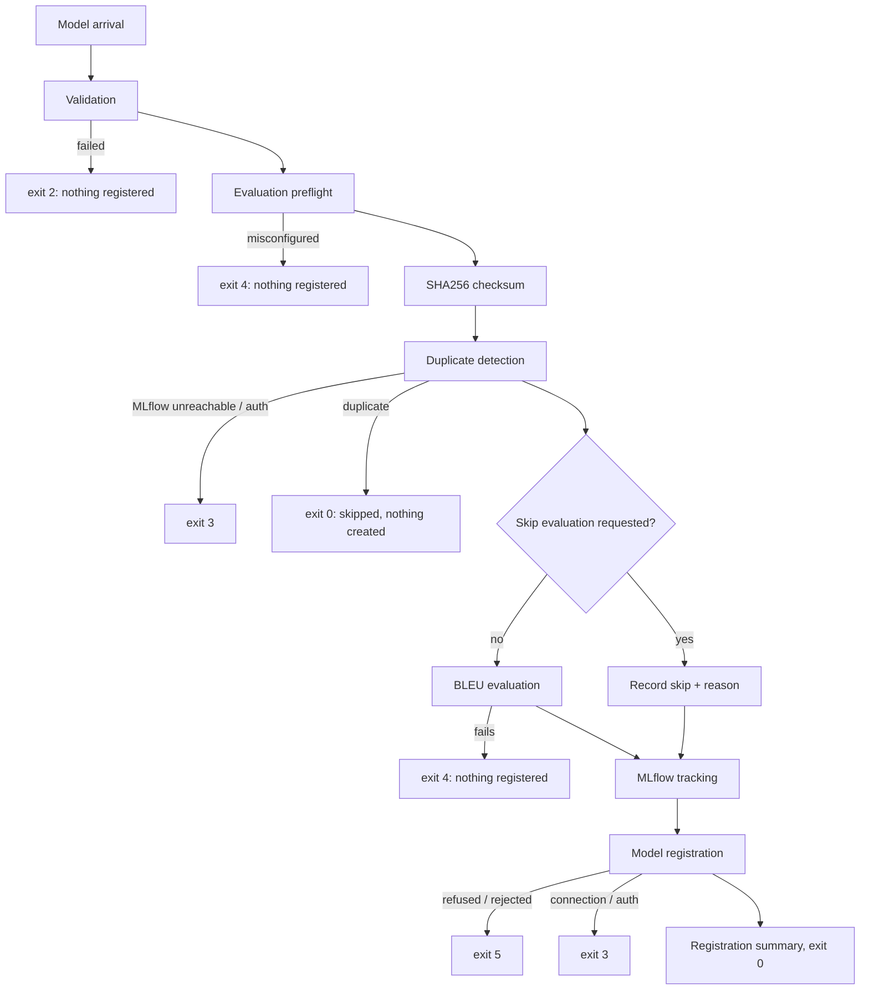

# Architecture

## Purpose and scope
A small, standalone pipeline that takes a converted CTranslate2 model directory (trained with
OpenNMT), checks it, fingerprints it, avoids re-registering the same artifact, evaluates it with
SacreBLEU, and records the result in MLflow with a registered model version.

Out of scope by design: serving APIs, Kubernetes/deployment, LLM/agent components, dashboards,
extra databases, and any access to MLflow's backend database. The only integration point is the
public `MlflowClient` API.

## Pipeline



The duplicate check deliberately runs **before** the expensive evaluation, and the evaluation
configuration is checked **before** any network call, so misconfiguration fails fast.

## Modules

| Module | Responsibility | Depends on |
|---|---|---|
| `register_ctranslate2_model.py` | CLI, orchestration, exit codes | all services |
| `services/model_validation.py` | structural validation of the model directory | stdlib |
| `services/checksum.py` | deterministic directory SHA256 (`sha256-dir-v1`) | stdlib |
| `services/duplicate_detection.py` | find a registered version with the same checksum; MLflow error classification | `mlflow` |
| `services/bleu_evaluation.py` | dataset loading, batched translation, SacreBLEU, translator loading | `sacrebleu` (`ctranslate2` lazily, adapter only) |
| `services/mlflow_service.py` | experiment, params/metrics/tags/artifacts, registration, status lifecycle | `mlflow`, the three modules above |
| `mock_data/` | dummy model, **synthetic** dataset, development-only mock translator | - |
| `scripts/verify_real_environment.py` | automated real-environment verification | stdlib (drives a venv) |

`bleu_evaluation` has no MLflow dependency; `mlflow_service` consumes its result object.
`mlflow_service` takes the client as an argument (no global MLflow state), which is what makes the
whole registration path testable with a fake client.

## What is recorded in MLflow
Artifacts: `model/` (the model directory) and `evaluation/evaluation_result.json` (when evaluated).

| Kind | Keys |
|---|---|
| Params | `model_name`, `model_folder`, `training_framework`, `model_format`, `serving_runtime`, `quantization`, `device`, `source_language`, `target_language`, `training_checkpoint`, `dataset_version`; when evaluated: `eval_dataset_version`, `eval_batch_size`, `eval_bleu_tokenize`, `eval_bleu_lowercase`, `eval_bleu_smooth_method` |
| Metrics | `bleu` (manually supplied only), `bleu_auto`, `evaluation_sentence_count` |
| Tags (run and version) | `model_sha256`, `model_sha256_algorithm`, `model_type`, `artifact_type`, `evaluation_status`, `evaluation_type`, `bleu_source`, `registration_status`; optionally `evaluation_skip_reason`, `evaluation_error`, `sacrebleu_signature` |

### Status vocabularies
| Tag | Values | Meaning |
|---|---|---|
| `evaluation_status` | `completed`, `skipped`, `failed` | `failed` is only recorded if a caller of the service opts in with `allow_failed_evaluation`; the CLI never registers after a failed evaluation |
| `evaluation_type` | `automatic`, `synthetic`, `manual`, `none` | `automatic` = automatic BLEU on a real dataset; `manual` = only a user-supplied `--bleu` |
| `evaluation_skip_reason` | `translator_not_configured`, `evaluation_not_requested` | present only when skipped |
| `bleu_source` | `automatic`, `manual`, `manual+automatic`, `none` | which BLEU metrics exist |
| `registration_status` | `pending`, `registered`, `failed` | see lifecycle below |

### Registration status lifecycle
```
run:      pending ──(version READY)──► registered      any error after run creation ──► failed (run FAILED)
version:  pending ──(version READY)──► registered      error after version creation ──► failed
```
A version is only ever labelled `registered` after MLflow reports it `READY`. Versions that end
`failed` (or with MLflow status `FAILED_REGISTRATION`) are ignored by duplicate detection, so the
same artifact can be registered again.

## Errors and exit codes
| Exception | Raised for | CLI exit |
|---|---|---|
| (validation result `failed`) | invalid model directory | 2 |
| `MLflowConnectionError` | server unreachable, 5xx/internal errors | 3 |
| `MLflowAuthError` (subclass) | 401/403-type errors; message names the `MLFLOW_TRACKING_*` variables | 3 |
| `EvaluationConfigError`, `DatasetError`, `EvaluationError` | evaluation not configured / bad data / translator failure | 4 |
| `RegistrationError` | registration refused (e.g. undeclared evaluation) or rejected by MLflow | 5 |
| argparse usage error (including invalid `--bleu`) | bad arguments | 2 |

## Configuration surface
Environment (see `.env.example`): `MLFLOW_TRACKING_URI`, `MLFLOW_EXPERIMENT_NAME`,
`MODEL_REGISTRY_NAME`, `EVALUATION_DATASET_VERSION`, optional `TRANSLATOR_FACTORY`.
Credentials are never read or stored by this code; MLflow reads `MLFLOW_TRACKING_USERNAME`,
`MLFLOW_TRACKING_PASSWORD` or `MLFLOW_TRACKING_TOKEN` itself.

## Safety boundaries
- The tracking URI is explicit (argument, then env, then `http://127.0.0.1:5000`).
- `artifact_location` is only passed when explicitly given, so the server's artifact configuration is untouched.
- No direct database access; no PostgreSQL configuration is read or modified.
- The verification script and the integration tests use throw-away SQLite stores and strip `MLFLOW_*` variables.

## Extension points
- **Translator**: any object with `translate_batch(list[str]) -> list[str]`, supplied through `--translator package.module:callable`.
- **Real model**: write a factory `callable(model_dir, device)` that builds a `CTranslate2Translator` with your tokenizer/detokenizer.
- **Dataset**: pass real files with `--evaluation-type real` and a dataset version.
